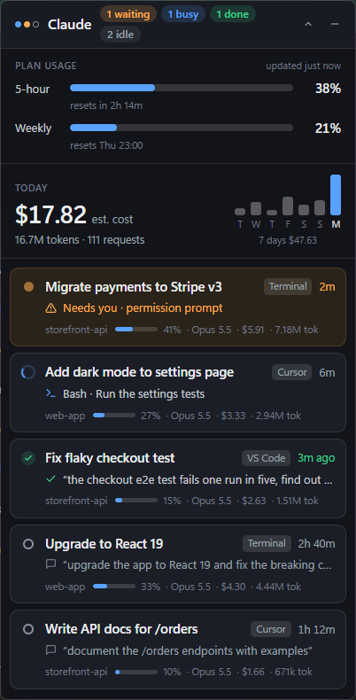
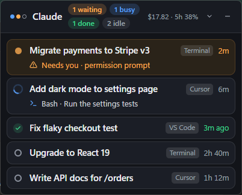
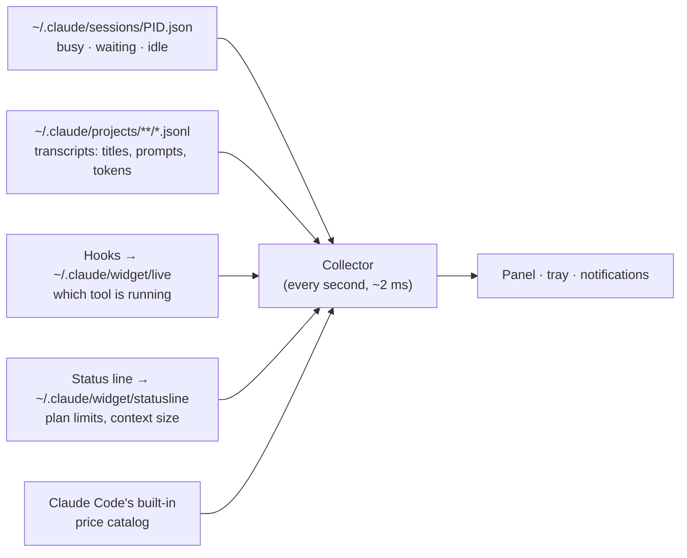

# Claude Widget

**A small always-on-top desktop panel that shows what every Claude Code session is doing.** It shows which sessions are working, which one needs you, which just finished, what they cost, and how close you are to your plan limits. It runs on Windows, macOS and Linux.

<p align="center">
  
  &nbsp;&nbsp;
  
</p>

> Unofficial community project. Not affiliated with or endorsed by Anthropic.

---

## Contents

- [Features](#features)
- [Platforms](#platforms)
- [Install](#install): [Windows](#windows) · [macOS](#macos) · [Linux](#linux)
- [Using the widget](#using-the-widget)
- [How it works](#how-it-works)
- [What it changes on your machine](#what-it-changes-on-your-machine)
- [Uninstall](#uninstall)
- [Estimated cost: how accurate is it?](#estimated-cost-how-accurate-is-it)
- [Troubleshooting and FAQ](#troubleshooting-and-faq)
- [Command line](#command-line)
- [Project layout and development](#project-layout-and-development)

## Features

- **Every live Claude Code session in one place.** Terminal sessions and the VS Code / Cursor extension are both shown, each with its title, folder and the app it runs in.
- **Status at a glance.** Sessions sort in this order:
  - **Needs you** (amber, with the reason, e.g. *permission prompt*)
  - **Busy**
  - **Done** (finished in the last 10 minutes)
  - **Idle**
- **What it's doing right now,** e.g. `Bash · Run the settings tests` or `Edit · checkout.ts`. When it's idle, you see your last prompt.
- **Click a session to jump to its window,** whether that's the right Cursor / VS Code window or terminal tab.
- **Notifications** when a session needs you, or finishes a long task.
- **Plan limits:** 5-hour and weekly usage, with reset times.
- **Estimated cost and tokens:** today, per session, and a 7-day chart. Prices come from Claude Code's own price table.
- **Context window use** for each session.
- **Compact view, adjustable text size, always on top, start at login.**
- **Local only:** it reads files Claude Code already writes on your machine. No network calls, no API keys, no telemetry.

## Platforms

| Platform | App | Source | Status |
|---|---|---|---|
| **Windows 10 / 11** | Native C# / WPF, about 75 MB of memory | [`src/`](src), [`build.cmd`](build.cmd) | Tested |
| **Linux** | Electron, about 150 MB | [`macos-linux/`](macos-linux) | Tested (Ubuntu); `.deb` and AppImage build |
| **macOS** | Electron (menu bar app) | [`macos-linux/`](macos-linux) | Builds the same way, **not yet tested on a Mac** |

Both apps read the same files and show the same numbers.

## Install

**You need [Claude Code](https://claude.com/claude-code)** installed and used at least once, plus `git` to download this repo.

### Windows

No Visual Studio or SDK is needed. It builds with the C# compiler that ships with Windows (.NET Framework 4.8).

```bat
git clone https://github.com/sandeshthapa07/calude-widget.git
cd calude-widget
build.cmd
bin\claude-widget-cli.exe install
```

`install` does the following:

1. Copies the app to `%USERPROFILE%\.claude\tools\claude-widget\`.
2. Adds the widget's hooks and status line to `~/.claude/settings.json` (see [what changes](#what-it-changes-on-your-machine)).
3. Creates a Start Menu shortcut named **Claude Widget**.
4. Starts the widget.

To start it with Windows, use the tray icon → **Start with Windows**.

**Updating:** `git pull`, then run `build.cmd` and `bin\claude-widget-cli.exe install` again.

### macOS

You need [Node.js](https://nodejs.org) 18 or newer to build.

```sh
git clone https://github.com/sandeshthapa07/calude-widget.git
cd calude-widget/macos-linux
npm install
npm start               # run it now
npm run dist:mac        # or build "Claude Widget.dmg" into macos-linux/dist/
```

1. **Turn on live tool names and plan limits.** Click the menu bar icon (right-click opens the menu) → **Install Claude Code hooks and status line**. From a terminal, `node cli.js install` does the same.
2. **First launch of the built app.** It isn't signed, so right-click it → **Open** the first time. Or run `xattr -dr com.apple.quarantine "/Applications/Claude Widget.app"`.
3. **Permissions.** Clicking a terminal session switches to its exact Terminal / iTerm2 tab, and macOS asks once for permission. Clicking a Cursor / VS Code session brings that app forward. If you also grant **Accessibility** permission, it raises the exact window for that folder.
4. **Start at login:** menu bar icon → **Open at login**.

### Linux

You need [Node.js](https://nodejs.org) 18 or newer to build.

```sh
git clone https://github.com/sandeshthapa07/calude-widget.git
cd calude-widget/macos-linux
npm install
npm start                                   # run it now, or build packages:
npm run dist:linux                          # -> dist/claude-widget_<version>_amd64.deb and .AppImage
sudo apt install ./dist/claude-widget_*_amd64.deb
```

1. **Turn on live tool names and plan limits.** Tray icon → **Install Claude Code hooks and status line**, or `node cli.js install`.
2. **Optional: click to focus.** `sudo apt install wmctrl`. This works for X11 and XWayland windows; native Wayland windows can't be raised by another app.
3. **Optional: tray icon.** It needs an AppIndicator host. Ubuntu has one built in. On plain GNOME, add the *AppIndicator and KStatusNotifierItem Support* extension.
4. **AppImage:** it needs `libfuse2`, or run it with `APPIMAGE_EXTRACT_AND_RUN=1`.
5. **Start at login:** tray icon → **Start at login**.

More macOS and Linux details are in [`macos-linux/README.md`](macos-linux/README.md).

## Using the widget

| Icon | State | Meaning |
|---|---|---|
| amber pulsing dot | **Needs you** | Waiting for a permission prompt or your answer. The card turns amber, and you get a notification. |
| blue spinner | **Busy** | Working. The second line shows the tool it's running. |
| green check | **Done** | Finished in the last 10 minutes. |
| grey ring | **Idle** | Waiting for your next prompt. |

- **Click a session** to bring its window to the front. **Hover** for details: folder, context use, cost and token breakdown.
- **Drag the header** to move the panel. It remembers its position, and it never extends past the bottom of the screen; long lists scroll.
- **Buttons in the header:** **⌃** switches between full and compact view. **–** hides the panel to the tray / menu bar.
- **Text size:** tray menu → *Text size*, or **Ctrl + mouse wheel** over the panel.
- **Tray / menu bar menu:** compact view, always on top, notifications, start at login, move to the top-right corner, quit.
- **Terminal footer.** Once the widget's status line is installed, Claude Code's terminal footer shows a line like:
  ```
  Opus 5.5 · ctx 34% · 5h 16% · 7d 12%
  ```

## How it works

Claude Code already records most of what the widget needs. The widget reads those files once a second and only reads the new parts.



| What you see | Where it comes from |
|---|---|
| Live sessions, busy / needs you / idle | `~/.claude/sessions/<pid>.json`, which Claude Code itself writes (`status`, `waitingFor`). The widget checks each process is really alive and started at the recorded time, so leftovers from crashed sessions never show. |
| Title, last prompt, model, tokens, context | The session's transcript, plus its subagents' transcripts. Each API response is counted once (by `requestId`), even though Claude writes it several times. |
| The tool running right now | The widget's hooks. They run asynchronously, so Claude never waits for them, and they write one small marker file per tool call. |
| Plan limits and exact context size | The widget's status line, which saves the `rate_limits` and `context_window` data Claude Code passes to every status line. |
| Prices | Read from the installed Claude Code binary (cached per version, refreshed when Claude updates), with a built-in fallback table. |
| Which window to focus | Windows: window titles. macOS: the session's tty for Terminal / iTerm2, the app for IDEs. Linux: `wmctrl` and window titles. |

## What it changes on your machine

- **`~/.claude/settings.json`**
  - Adds **async hooks** for `PreToolUse`, `PostToolUse`, `PostToolUseFailure`, `UserPromptSubmit`, `Stop` and `SessionEnd`, placed *after* any hooks you already have.
  - Sets the **status line**, but only if you don't already have one. Your own status line is never replaced. In that case plan limits stay off.
  - Saves the original once as `settings.json.bak-claude-widget`, and keeps the file's line endings and key order.
- **`~/.claude/tools/claude-widget/`** holds the hook program: `claude-widget-hook.exe` on Windows, `claude-widget-hook.sh` on macOS / Linux. On Windows the widget itself is installed here too.
- **`~/.claude/widget/`** holds the widget's own data: running-tool markers, status line captures, the price cache, settings (position, size, view) and an error log.
- The only other things it adds are a Start Menu shortcut (Windows) and, if you turn it on, a start-at-login entry.

## Uninstall

**Windows**

```bat
%USERPROFILE%\.claude\tools\claude-widget\claude-widget-cli.exe uninstall
```

This removes the hooks, the status line, the Start Menu shortcut and the autostart entry. Then delete `%USERPROFILE%\.claude\tools\claude-widget` and `%USERPROFILE%\.claude\widget` if you like.

**macOS / Linux**

1. Tray / menu bar icon → **Remove Claude Code hooks and status line** (or `node cli.js uninstall`).
2. Delete the app.
3. Optionally delete `~/.claude/tools/claude-widget` and `~/.claude/widget`.

## Estimated cost: how accurate is it?

- **Same calculation as Claude Code.** It uses Claude Code's own per-model price table and the same rules: 5-minute and 1-hour cache writes priced separately, fast mode, US-only inference ×1.1, and web searches. Compared with the cost Claude Code reports for the same session, it was within about 1%. The small gap is background requests that don't appear in transcripts.
- **It's API pricing.** On a Pro / Max / Team plan that's **not your bill**; the plan-limit bars show what counts for you.
- **Token totals include cache reads,** which are usually most of the volume. Hover today's cost for the breakdown.

## Troubleshooting and FAQ

**A session doesn't show up.**
Run `claude-widget-cli snapshot` (Windows) or `node cli.js snapshot` (macOS / Linux). It prints exactly what the widget sees. A brand-new session appears within a second or two, at first titled with your prompt; Claude's AI title replaces it shortly after.

**Plan limits are empty.**
Claude Code sends plan limits only to the **status line**, and only **terminal** sessions run a status line; the VS Code / Cursor extension doesn't. Open any terminal Claude session and the limits fill in. The panel shows "updated X ago", and drops numbers once their window has reset. If you have your own status line, the widget leaves it alone and limits stay off.

**No tool names, it only says "Working…".**
The hooks aren't installed. Run `install`, or use the tray menu item.

**Clicking a session doesn't switch windows.**
- macOS: allow the permission prompt, or check *System Settings → Privacy & Security → Automation / Accessibility*.
- Linux: install `wmctrl`. It doesn't work for native Wayland windows.

**Does it send anything anywhere?**
No. It only reads local files and never makes network requests.

**Does it work with the Claude desktop app or claude.ai?**
No. It shows **Claude Code** sessions only: the terminal CLI and the IDE extensions.

**How much does it use?**
- Windows app: about 2–3% of one CPU core while a session is busy (the spinner), about 75 MB of memory.
- Electron app: about 150 MB of memory.
- A refresh takes about 2 ms.

**A Claude Code update broke something.**
The widget reads Claude Code's internal files, and their format can change. It was built and tested against Claude Code **2.1.325**. Run `snapshot` and [open an issue](https://github.com/sandeshthapa07/calude-widget/issues) with the output.

## Command line

| Windows | macOS / Linux | Does |
|---|---|---|
| `claude-widget-cli snapshot [--json]` | `node cli.js snapshot [--json]` | Print what the widget sees right now |
| `claude-widget-cli watch [seconds]` | `node cli.js watch [seconds]` | Print every change in state, title or prompt |
| `claude-widget-cli windows` | | Show which window a click on each session would focus |
| `claude-widget-cli install [--no-start]` | `node cli.js install` | Add hooks and status line (Windows also installs the app) |
| `claude-widget-cli uninstall` | `node cli.js uninstall` | Remove them again |

## Project layout and development

```
.
├── src/                  Windows app (C# 5, WPF, no XAML)
│   ├── Core.cs           JSON, process/window helpers, transcript reader, prices, collector, installer
│   ├── Widget.cs         the panel, tray icon, notifications
│   └── Hook.cs           hook + status line handler and the CLI (built twice)
├── build.cmd             builds bin\ClaudeWidget.exe, claude-widget-hook.exe, claude-widget-cli.exe
├── assets/               icons
├── macos-linux/          Electron app for macOS and Linux
│   ├── main.js           window, tray / menu bar, notifications, login item
│   ├── lib/              collector, transcripts, prices, processes, installer (same logic as Core.cs)
│   ├── ui/               the panel (HTML / CSS / JS)
│   ├── hook/             claude-widget-hook.sh (POSIX sh, no dependencies)
│   └── cli.js            snapshot / watch / install / uninstall
└── docs/                 screenshots
```

- **Windows.** `build.cmd` uses `%WINDIR%\Microsoft.NET\Framework64\v4.0.30319\csc.exe`, which only supports **C# 5**: no `$"..."` and no `?.`.
- **macOS / Linux.** `npm start` runs from source. Electron downloads its binary on first run.
- **Testing without touching your real setup.** Both apps honour `CLAUDE_CONFIG_DIR`. Point it at a folder with fake `sessions/` and `projects/` files to try changes safely. `watch` prints every change it sees.

## License

No license has been chosen yet, so all rights are reserved by the author until one is added.
